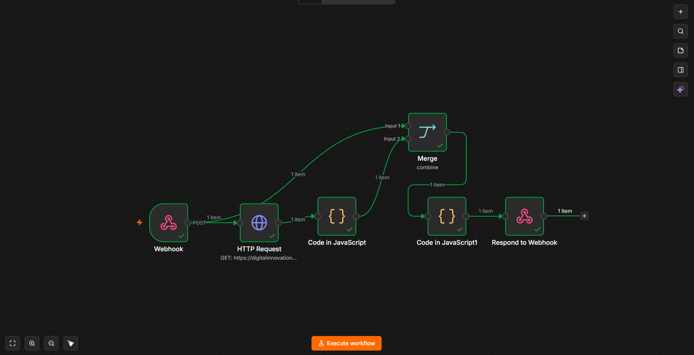
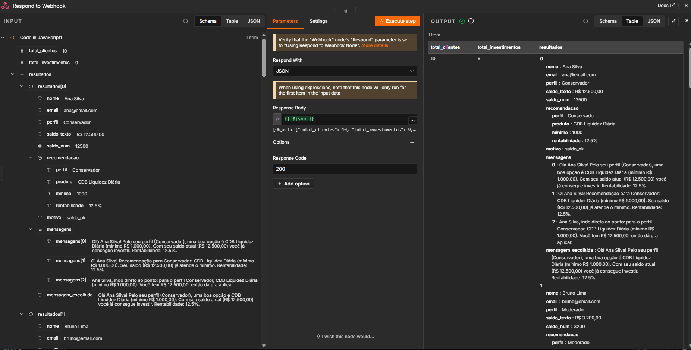

# Assistente de Investimentos com RPA + n8n

Projeto do lab da DIO: um script Python (RPA) lê uma lista de clientes de uma página web e envia para um workflow do n8n, que recomenda um investimento para cada cliente e gera as mensagens.

## Estrutura do repositório

```
├── README.md
├── docs/
│   ├── index.html          # página com a lista de clientes
│   └── data.csv            # opções de investimento
├── rpa/
│   ├── extrair_clientes.ipynb   # notebook (TODO do POST concluído)
│   └── rpa.py                   # versão usada na execução, rodando local
├── n8n/
│   ├── workflow.json            # MVP (mensagens estáticas)
│   └── workflow-completo.json   # versão com IA (Google Gemini)
└── prints/                      # evidências do funcionamento
```

## Como funciona

1. O `rpa.py` baixa a página de clientes, lê a tabela com BeautifulSoup e envia a lista (JSON, via POST) para o Webhook do n8n.
2. O n8n busca o `data.csv` de investimentos e transforma cada linha em um item.
3. Um nó Merge junta os clientes com os investimentos.
4. Um nó Code escolhe o produto de cada cliente e monta 3 mensagens, sorteando uma delas.
5. O Respond to Webhook devolve o resultado em JSON.

### Fluxo do MVP

`Webhook → HTTP Request (CSV) → Code → Merge → Code (mensagens) → Respond to Webhook`

### Versão completa (com IA)

`... → Code (mensagens) → Preparar dados → AI Agent (Gemini) → Normalizar emails → Respond to Webhook`

- **Preparar dados:** transforma os clientes e as recomendações em uma tabela organizada para a IA.
- **AI Agent:** usa o modelo **Gemini 3 Flash (preview)**, pela API do Google Gemini (plano gratuito), para escrever um e-mail por cliente, em JSON.
- **Normalizar emails:** limpa a resposta da IA (tira blocos de código e asteriscos), recusa textos que prometem ganho garantido, adiciona o aviso de risco e gera o corpo em HTML. Se a IA falhar, usa a mensagem padrão do MVP.

O envio por Gmail não foi implementado, mas a saída já tem `assunto` e `html_body` prontos para ele.

## Regra de recomendação

Para cada cliente, o código filtra os investimentos do perfil dele e escolhe o de **maior valor mínimo que o saldo consegue pagar**. Se nenhum serve, indica o de menor mínimo e marca o motivo como `saldo_insuficiente`.

## Como executar

1. Suba o n8n (no meu caso, Docker local) e importe `n8n/workflow.json`.
2. Abra o nó **Webhook** e confira que o Path é `Clientes`. Clique em **Listen for test event**.
3. Instale as dependências e rode o script:

```bash
pip install requests beautifulsoup4
python rpa/rpa.py
```

4. O esperado é `Status: 200` no terminal e os dados no OUTPUT do Respond to Webhook.

O webhook de teste vale para **uma chamada**, então é preciso clicar em "Listen for test event" antes de cada execução.

Para a versão completa, importe `n8n/workflow-completo.json`, crie a sua credencial do Google Gemini (chave gratuita no Google AI Studio) e selecione o modelo `gemini-3-flash-preview` no nó Google Gemini Chat Model. Como é um modelo preview, o nome pode mudar com o tempo: se ele não aparecer na lista, escolha outro modelo Flash da série 3. As credenciais não vão no arquivo exportado.

## Decisões técnicas

- **RPA rodando local:** o Colab roda nos servidores do Google e não alcança o `localhost` do n8n no Docker. Por isso a execução real usa o `rpa.py`, com a mesma lógica do notebook. O notebook também tem o POST implementado.
- **Nó Code em JavaScript:** o Python do nó Code não está disponível na imagem do n8n que uso.
- **Merge:** une clientes e investimentos num único item para o código decidir de uma vez.
- **Uma chamada de IA para todos os clientes:** a tabela inteira vai de uma vez, o que economiza o limite do plano gratuito.
- **Normalização com mensagem padrão de reserva:** a IA pode errar o formato ou prometer retorno; o fluxo continua funcionando mesmo assim.

## Evidências





## Limitações

- O envio por Gmail não foi concluído (etapa opcional).
- Os e-mails dos clientes são fictícios.
- O webhook de teste exige acionar o "Listen for test event" a cada execução.
- O modelo de IA é um preview e pode ficar instável (já recebi erro 503 de sobrecarga); por isso o fluxo tem a mensagem padrão como reserva.
